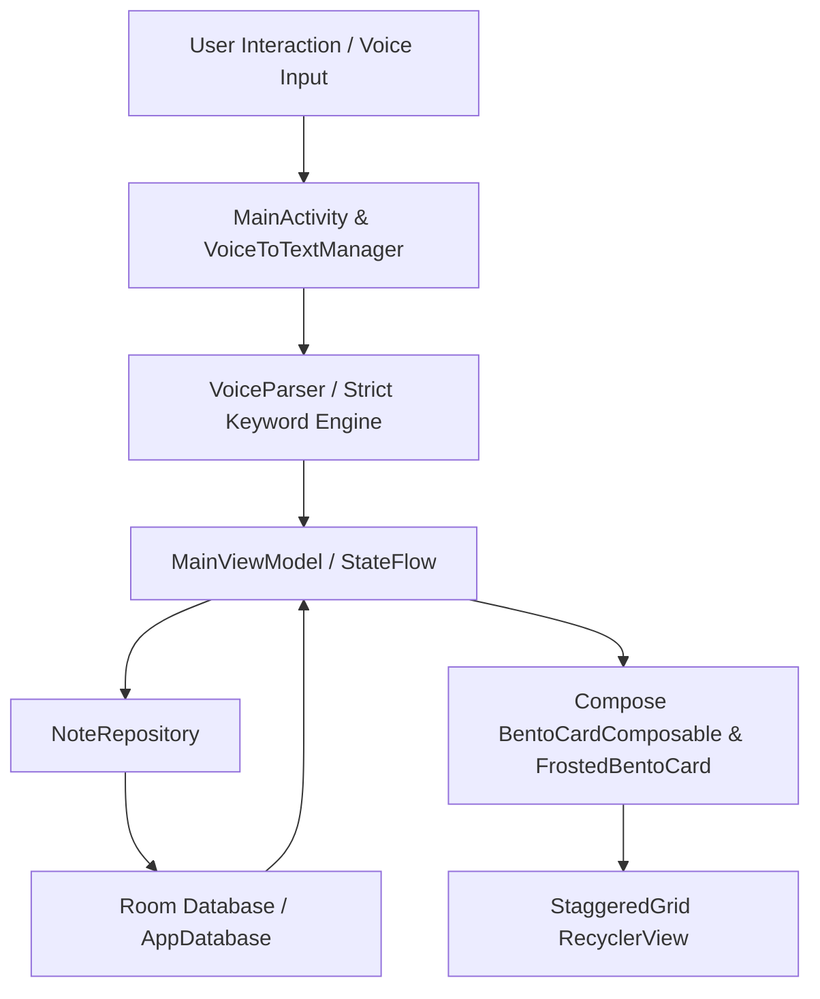

# NO.MEMO — Nothing OS 5.0 Bento Notes & Studio

<p align="center">
  
  
  
  
  
  
</p>

---

> **NO.MEMO** is a production-grade, high-performance Android application built in Kotlin. It meticulously implements the iconic industrial, monochromatic, and glassmorphic design system of **Nothing OS 5.0**, featuring hardware-accelerated frosted glass refraction, continuous Skia dot-matrix GPU canvas animations, and a silent background speech transcription engine.

---

## ✨ Key Technical Highlights & Features

### 🧊 3-Layer Specular Frosted Glass Cards
A custom hardware-accelerated frosted glass compositing architecture (`FrostedBentoCard.kt` & `Modifier.frostedGlass`) that solves foreground blur bleed:
```
┌─────────────────────────────────────────────────────────────┐
│ LAYER 3: Razor-Sharp Unblurred Content (Text, Media, Icons)  │
├─────────────────────────────────────────────────────────────┤
│ LAYER 2: Specular Rim Border (Top-Left White -> Bottom-Right)│
├─────────────────────────────────────────────────────────────┤
│ LAYER 1: Background Glass Blur (20.dp Hardware Blur + Tint) │
└─────────────────────────────────────────────────────────────┘
```
* **Hardware Blur (API 31+)**: Applies `Modifier.blur(20.dp)` exclusively to the background container layer.
* **Specular Rim Gradient**: A diagonal `Brush.linearGradient` running from `Color.White.copy(alpha = borderAlpha)` down to `Color.Transparent`, mimicking light refracting off beveled glass edges.
* **Razor-Sharp Typography**: Titles, body text, image previews, and icons sit on Layer 3 with 100% crisp clarity.

### 🎙️ Silent Background Voice Engine & Keyword Parser
An in-app voice transcription engine (`VoiceToTextManager.kt`) that operates silently in the background:
* **Zero Google UI Dialogs**: Binds locally via `SpeechRecognizer.createSpeechRecognizer(context)` without triggering system dialog popups.
* **Real-time Partial Results**: Streams word-by-word transcription as speech occurs (`EXTRA_PARTIAL_RESULTS = true`).
* **Continuous Persistent Session**: Maintains a single persistent speech recognizer instance to eliminate microphone toggling or audio stream hitches mid-sentence.
* **Strict Keyword Title Parsing (`VoiceParser.kt`)**: All spoken text defaults 100% to the note Body unless the user explicitly speaks `"title [your title]"` or `"title [your title] body [your body]"`.
* **Full-Screen 40dp Backdrop Blur**: When active, a 40dp hardware blur backdrop softly dims background UI clutter, putting the live audio waveform (`NothingAudioWaveform`) and streaming transcript in sharp focus.

### 🎨 Procedural Skia GPU Canvas Dot-Matrix Background
* **Zero-Allocation Drawing Loop**: Eliminates all object (`Pair` / `Color.copy`) allocations inside `drawCircle` loops to guarantee zero GC jank during high-speed scrolling.
* **60 FPS Wave Pacing**: Capped at a 3600ms linear loop for smooth wave pacing and minimal battery draw.
* **Touch-Interactive Wave Ripples**: Tap gestures generate expanding ripple vectors that interact dynamically with the traveling wave.

### 🔤 Kinetic Dot-Matrix Typography & Telemetry HUD
* **Mechanical Matrix Scramble (`KineticDotMatrixText`)**: Simulates Nothing's hardware LED dot-matrix display. Headers and titles kinetically scramble through random glyphs (`░`, `▒`, `▓`, `•`, `*`, `0`, `1`, `X`) before locking into place.
* **Live Telemetry HUD (`KineticTelemetryValue`)**: Real-time monospace telemetry at the base of the screen calculating typing speed (**WPM**), word count, character count, and estimated reading time with zero perceptible latency.

### ⚡ Zero-Friction "Flash Note" Quick-Draw Scratchpad
* **0ms Scratchpad Overlay (`FlashNoteOverlay`)**: Tap or flick the bottom dock to instantly summon a specular frosted scratchpad with immediate keyboard focus, auto-hashtag recognition (`#idea`, `#urgent`, `#work`), and 1-tap persistence without opening a separate activity.
* **Direct In-Bento Checklist Toggling**: Tap checklist items directly on the home grid cards to mark them complete/incomplete with mechanical haptic ticks—zero need to enter the editor.

### 🎙️ Voice Memo 2.0 & Interactive Dot-Matrix Waveform Player
* **High-Fidelity Audio Memos (`AudioRecorderManager`)**: Simultaneously records `.m4a` AAC audio alongside real-time speech transcription, calculating amplitude waveforms on the fly.
* **Scrubbable Waveform Player (`DotMatrixAudioPlayer`)**: Interactive Nothing OS dot-matrix audio player right inside the Bento card with Play/Pause mechanical toggles, scrubbable amplitude dots, and elapsed time telemetry (`00:14 // 00:30`).

### 🔒 Glyph Lock (Privacy & Data Archival)
* **Dot-Matrix Privacy Mask**: Tap to encrypt/lock confidential notes; cards conceal their contents with an animated matrix scramble pattern (`░░ GLYPH LOCKED // TAP TO REVEAL ░░`).
* **Instant Export & Markdown Backup**: Single-tap export of the entire workspace into structured Markdown / JSON packages.

### 🪄 100% Pure Jetpack Compose 120 FPS Architecture
* Migrated from hybrid ViewBinding/RecyclerView to an entirely pure Jetpack Compose pipeline (`MainNotesScreen`, `NothingNoteEditorScreen`, `NothingSettingsScreen`), eliminating bridge overhead for silky 120 FPS performance on Nothing Phone displays.

### 💡 Nothing Phone Glyph LED Simulator
* **Interactive Hardware Glyph Array (`NothingGlyphInterface`)**: Models the Camera Ring, Diagonal Slash, G-Loop, and Exclamation LEDs, pulsing in real time to audio volume (RMS dB) and playback.

### ✏️ 1-Bit "Dot-Matrix Doodle" Canvas
* **Mechanical Sketchpad (`DotMatrixDoodleSheet`)**: 1-bit monochrome and Nothing Crimson drawing canvas for handwritten notes and diagrams, with automatic PNG rasterization and direct attachment to notes.

### 📱 Physical Homescreen Glyph Bento Widget
* **AppWidget Studio (`NothingBentoWidgetProvider`)**: 4x2 / 2x2 Nothing OS bento widget for the Android homescreen featuring NDot typography, latest note previews, and 1-tap quick capture triggers.

### 🧠 Smart Note Intelligence Engine
* **Offline Local Extraction (`SmartNoteIntelligence`)**: Automatically converts natural language prose into checklists, detects urgency tags, and extracts hashtags without network latency.

---

## 🛠 Tech Stack & Dependencies

| Category | Component / Library | Version | Description |
| :--- | :--- | :--- | :--- |
| **Language** | Kotlin | `2.2.10` | Modern, safe Kotlin stdlib |
| **UI Framework** | Jetpack Compose | `2024.10.01` | Declarative UI & Canvas Shaders |
| **UI Components** | ViewBinding + Material 3 | `1.12.0` | Staggered Grid RecyclerView & Floating Dock |
| **Database** | Room Database | `2.6.1` | Local SQLite ORM with KSP codegen |
| **Image Engine** | Coil Compose | `2.7.0` | Asynchronous off-thread image loading |
| **JSON Serialization** | Gson | `2.10.1` | TypeConverters for List<ChecklistItem> & List<String> |
| **Concurrency** | Kotlin Coroutines & StateFlow | `2.8.7` | Reactive asynchronous state management |

---

## 🏗 Architecture Diagram



---

## 📁 Directory Structure

```
com.example.nomemo
├── data
│   ├── db           # AppDatabase, NoteDao, & Gson Converters
│   ├── entity       # Room Note Entity & NoteType Constants
│   ├── model        # ChecklistItem Model
│   ├── pref         # PreferencesManager (Pitch Black, Glassmorphism, Haptics)
│   └── repository   # NoteRepository Layer
├── ui
│   ├── adapter      # NoteBentoAdapter, AttachedMediaAdapter, ChecklistAdapter
│   ├── anim         # Snappy RubberBand Spring Animations
│   ├── compose      # NothingDotMatrixBackground, FrostedBentoCard, NothingVoiceOverlay, NothingAudioWaveform, NothingSyncedTabs
│   ├── editor       # NoteEditorActivity (Auto-Save, Media, Checklist, Undo/Redo)
│   ├── settings     # SettingsActivity (Theme, Glassmorphism, Clear Data)
│   └── viewmodel    # MainViewModel (0ms In-Memory Pre-Filtering)
├── voice
│   ├── VoiceToTextManager.kt   # Persistent Silent Background Speech Engine
│   └── VoiceParser.kt          # Strict Keyword Title/Body Voice Parser
└── MainActivity.kt             # ViewBinding Dashboard & Floating Capsule Dock
```

---

## 🚀 Building & Installation

### Prerequisites
* **Android Studio**: Ladybug (2024.2+) or higher
* **JDK**: 17+
* **Target Device**: Android 8.0 (API 26+) or higher (Android 12+ recommended for hardware blur shaders)

### Build Commands
```bash
# Clone the repository
git clone https://github.com/your-username/nomemo.git
cd nomemo

# Build Debug APK
./gradlew assembleDebug

# Install directly on connected device via ADB
./gradlew installDebug
```

---

## 📄 License
Released under the **MIT License**.
Designed and engineered following the **Nothing OS 5.0 Bento Design Specification**.
