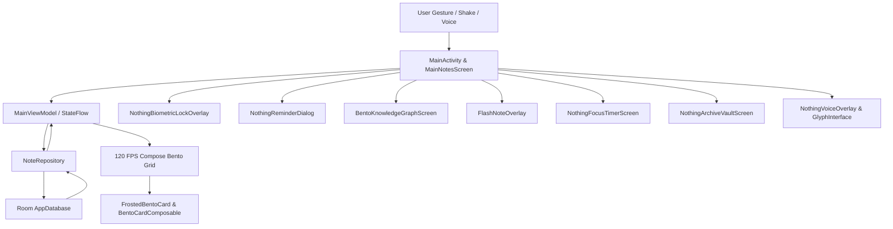

# NO.MEMO — Nothing OS 5.0 Bento Notes & Kinetic Studio

<p align="center">
  
  
  
  
  
  
</p>

---

> **NO.MEMO** is an unforgettable, zero-friction Android notes and ideation studio built in 100% pure Jetpack Compose. It faithfully embodies the iconic industrial, monochrome, and dot-matrix bento design language of **Nothing OS 5.0**—powered by 120 FPS hardware-accelerated Skia GPU canvases, procedural mechanical PCM audio synthesis, an interactive Nothing Phone Glyph LED simulator, live Markdown WYSIWYG rendering, an infinite 2D Bento Knowledge Graph, and a physical homescreen bento widget.

---

## ✨ System Architecture & Key Innovations

### 1. 🔤 Kinetic Typography & Telemetry Matrix
* **Mechanical Glyph Scrambler (`KineticDotMatrixText.kt`)**: Headers and cards scramble through pseudo-random matrix characters (`░`, `▒`, `▓`, `•`, `*`, `0`, `1`, `X`) before locking into place, mimicking the physical LED dot-matrix displays of Nothing hardware.
* **Real-time Live Telemetry HUD (`KineticTelemetryValue.kt`)**: Monospace telemetry calculates real-time typing speed (**WPM**), character count, word count, and reading duration with zero perceptible lag.

### 2. ⚡ Zero-Friction "Flash Note" Quick-Draw Scratchpad
* **0ms Scratchpad (`FlashNoteOverlay.kt`)**: Summon a frosted scratchpad with instant keyboard focus, auto-hashtag extraction (`#idea`, `#urgent`, `#dev`), and single-tap persistence directly to the SQLite Room database.
* **Physical Shake Gesture (`NothingShakeDetector.kt`)**: Shake the device to summon the scratchpad from anywhere without touching the screen.

### 3. 🎙️ High-Fidelity Audio Memo & Scrubbable Dot-Matrix Player
* **Zero-Loss AAC Voice Recording (`AudioRecorderManager.kt`)**: Records high-fidelity `.m4a` voice memos while capturing real-time amplitude waveforms.
* **Interactive Waveform Player (`DotMatrixAudioPlayer.kt`)**: Scrubbable dot-matrix waveform player built directly into Bento cards with mechanical haptic toggles and timestamp telemetry (`00:14 // 00:30`).

### 4. 💡 Nothing Phone Rear Glyph LED Simulator
* **Authentic Rear Glyph LED Array (`NothingGlyphInterface.kt`)**: Procedurally models the Camera Ring, Diagonal Slash, G-Loop, and Exclamation LEDs, pulsing in real time to voice RMS audio volume and playback.

### 5. 🔒 Glyph Biometric Hardware Vault
* **Optical Fingerprint Scanner (`NothingBiometricLockOverlay.kt`)**: Dot-Matrix concentric optical fingerprint sensor with dynamic touch-and-hold radial fill, mechanical tumbler release sounds, and 4-digit PIN fallback.
* **Privacy Shutter (`BentoCardComposable.kt`)**: Locked cards conceal contents behind an animated matrix privacy shield until authenticated.

### 6. 🕸️ 2D Bento Knowledge Graph Constellation
* **Infinite Pan & Zoom Canvas (`BentoKnowledgeGraphScreen.kt`)**: Visualizes all notes as interactive celestial nodes connected by laser vectors based on shared `#hashtags`. Tap any star node to instantly open the corresponding note.

### 7. 📝 Live Markdown WYSIWYG Renderer
* **WYSIWYG Markdown Engine (`NothingMarkdownRenderer.kt`)**: Renders `# Headers` in NDot uppercase typography, `> Blockquotes` with crimson accent bars, interactive `- [ ] Checkboxes`, and `` `code blocks` `` with 1-tap clipboard copying.

### 8. 🧾 1-Bit Thermal Receipt Exporter
* **Industrial Dot-Matrix Tape Exporter (`NothingReceiptExporter.kt`)**: Renders any note into an authentic monochrome receipt bitmap with perforated edges, cryptographic checksum, and Nothing Crimson red stamp, ready to share via Android's share sheet.

### 9. ⏱️ Focus Matrix (Pomodoro Studio) & 📦 Recovery Vault
* **Pomodoro Studio (`NothingFocusTimerScreen.kt`)**: 48-dot procedural circular glyph progress ring with kinetic countdown timer.
* **Archive & Recovery Vault (`NothingArchiveVaultScreen.kt`)**: Dedicated recovery space for archived and soft-deleted notes with 1-tap restore chimes and permanent shredding.

### 10. ⏰ Scheduled Reminders & Notification Alarms
* **System Reminders Engine (`NothingReminderManager.kt` & `NothingReminderDialog.kt`)**: Set timed reminders with quick presets (+1h, Tonight, Tomorrow morning, Custom) that trigger high-priority Nothing OS heads-up system notifications with action buttons.

### 11. ☑️ Multi-Select Batch Actions (Bulk Selection Mode)
* **Bulk Management**: Long press or tap the selection mode icon to batch-select multiple notes. Bulk Pin/Unpin, Lock/Unlock, Archive to Vault, or Shred with a single tap.

### 12. 🔊 Procedural Mechanical Audio Feedback Engine
* **Zero-Asset PCM Audio Synthesizer (`NothingAudioFeedback.kt`)**: Procedurally generates mechanical shutter clicks, metallic checkbox chimes, and tumbler bolt snaps directly via 16-bit PCM AudioTrack buffers with 0ms latency and 0 bytes APK overhead.

### 13. 📱 Physical Homescreen Glyph Bento Widget
* **AppWidget Studio (`NothingBentoWidgetProvider.kt`)**: 4x2 / 2x2 Nothing OS bento widget for the Android homescreen featuring NDot typography, latest note previews, and 1-tap quick capture triggers.

### 14. ✨ Smart Note Text Cleaner & Formatter
* **One-Tap Formatter (`SmartNoteIntelligence.kt`)**: Automatic text cleanup that trims excess whitespace, turns bullet points into interactive checklist items, and normalizes messy braindumps.

---

## 🌟 Quality of Life (QoL) Innovations

1. **Zero-Latency In-Memory Filtering**: Real-time note search and category tab filtering occur completely in-memory via Kotlin `StateFlow`, eliminating SQLite query delays while typing.
2. **Direct In-Bento Checklist Toggling**: Mark tasks complete/incomplete directly on home grid cards with a metallic chime sound—zero friction, no need to open the editor.
3. **Double-Shake Quick Draw**: Shake the device at any time to immediately open the Flash Note scratchpad with autofocus keyboard.
4. **Debounced Background Auto-Save**: Edits automatically persist every 350ms. Never lose a thought and never search for a manual save button.
5. **Full Undo / Redo Stacks**: Mistakes are instantly reversible with dedicated 1-tap Undo/Redo buttons in the editor.
6. **Time Machine Version Rollback**: Revert any note back to previous edits with a chronological snapshot scrubber.
7. **In-Card Scrubbable Audio Waveform**: Listen and scrub through voice memos directly on the dashboard without entering the editor.
8. **Soft-Delete Recovery Vault**: Accidental deletions can be inspected and restored with 1 tap, avoiding data loss.
9. **Scheduled System Reminders**: Schedule timed alarms with quick presets (+1h, Tonight, Tomorrow) that trigger native Android notifications.
10. **Multi-Select Batch Operations**: Select multiple notes at once to batch Pin, Lock, Vault, or Shred.
11. **1-Bit Thermal Receipt Sharing**: Export notes as high-resolution monochrome Nothing receipts with perforated margins and cryptographic checksums directly to messaging apps.
12. **Live WYSIWYG Markdown Preview**: Toggle between raw typing and live rendered headers, code blocks, and blockquotes with 1-tap code copying.
13. **Smart Note Text Cleanup**: 1-tap formatter that trims extra spacing, converts bullet points into interactive checklist items, and normalizes messy braindumps.
14. **Tactile Procedural Haptics & Sound**: 16-bit PCM procedural micro-clicks give physical hardware feedback with 0ms latency and 0 bytes APK overhead.
15. **Accent Palette Customizer**: Choose between Nothing Crimson (`#D71921`), Solar Amber (`#FF9500`), Neon Emerald (`#00FF66`), Electric White (`#FFFFFF`), and Cyan (`#00E5FF`).
16. **JSON / Markdown Workspace Export**: Export or back up the entire notes database with a single tap.

---

## 🛠 Tech Stack & Dependencies

| Category | Component / Library | Version | Description |
| :--- | :--- | :--- | :--- |
| **Language** | Kotlin | `2.2.10` | Modern, safe Kotlin stdlib |
| **UI Framework** | Jetpack Compose | `2024.10.01` | Pure Compose 120 FPS Architecture |
| **Database** | Room Database | `2.6.1` | Local SQLite ORM with KSP codegen (v3 schema) |
| **Image Engine** | Coil Compose | `2.7.0` | Asynchronous image rendering |
| **JSON Serialization** | Gson | `2.10.1` | TypeConverters for Checklists, Waveforms, & Revisions |
| **Audio Synthesis** | Android AudioTrack | Native | 16-bit PCM procedural audio feedback |
| **Concurrency** | Kotlin Coroutines & StateFlow | `2.8.7` | Reactive asynchronous state management |

---

## 🏗 Architecture Diagram



---

## 📁 Directory Structure

```
com.example.nomemo
├── data
│   ├── db           # AppDatabase (v4), NoteDao, Converters
│   ├── entity       # Room Note Entity & NoteType Constants
│   ├── model        # ChecklistItem, NoteRevision
│   ├── pref         # PreferencesManager (Pitch Black, Glassmorphism, Haptics, Accent)
│   └── repository   # NoteRepository
├── export
│   └── NothingReceiptExporter.kt   # 1-Bit Thermal Receipt & Tape Exporter
├── reminder
│   ├── NothingReminderManager.kt   # Native Android AlarmManager Scheduler
│   └── ReminderReceiver.kt         # Heads-Up System Notification Receiver
├── sensor
│   └── NothingShakeDetector.kt     # Hardware Accelerometer Gesture Engine
├── ui
│   ├── anim         # NothingAudioFeedback (Procedural PCM Audio Synthesizer)
│   ├── compose      # MainNotesScreen, FrostedBentoCard, NothingNoteEditorScreen,
│   │                # BentoKnowledgeGraphScreen, NothingMarkdownRenderer,
│   │                # NothingBiometricLockOverlay, NothingReminderDialog,
│   │                # NothingVersionHistorySheet, NothingFocusTimerScreen,
│   │                # NothingArchiveVaultScreen, DotMatrixAudioPlayer,
│   │                # DotMatrixDoodleSheet, FlashNoteOverlay,
│   │                # NothingGlyphInterface, KineticTypography
│   ├── editor       # NoteEditorActivity (Pure Compose Host)
│   ├── settings     # SettingsActivity & NothingSettingsScreen
│   └── viewmodel    # MainViewModel (0ms In-Memory Pre-Filtering)
├── voice
│   ├── AudioRecorderManager.kt     # AAC M4A Recorder & Waveform Engine
│   ├── VoiceToTextManager.kt       # Persistent Silent Speech Recognizer
│   └── VoiceParser.kt              # NLP Keyword Title & Body Parser
├── widget
│   └── NothingBentoWidgetProvider.kt # Android Homescreen Glyph Bento AppWidget
└── MainActivity.kt                 # Root Compose Dashboard Host
```

---

## 🚀 Building & Running

```bash
# Build the complete Debug APK
./gradlew assembleDebug

# Install on a connected physical device or emulator
./gradlew installDebug
```

Output APK: `app/build/outputs/apk/debug/app-debug.apk`

---

## 📄 License
Released under the **MIT License**.
Designed and engineered following the **Nothing OS 5.0 Bento Design Specification**.
