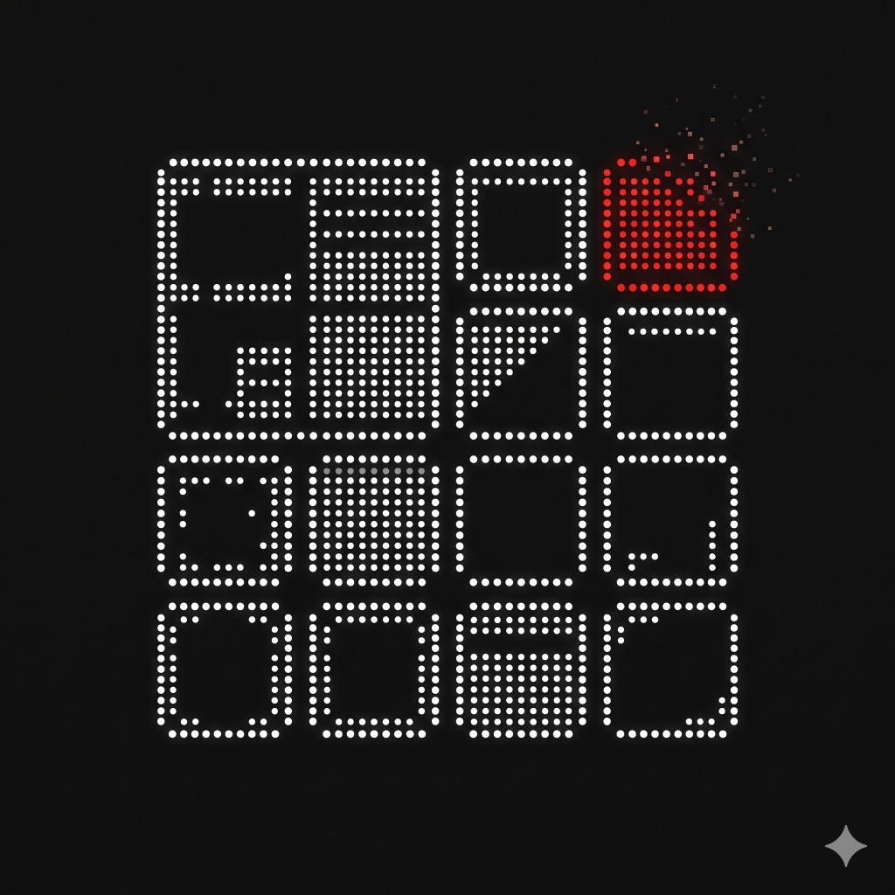

<div align="center">
  
  <h1>NO MEMO // v2.0.0</h1>
  <p><strong>Zero-bloat, offline-first spatial workspace engineered for Nothing OS & modern Android.</strong></p>

  <p>
    <a href="https://kotlinlang.org"></a>
    <a href="https://developer.android.com/jetpack/compose"></a>
    <a href="https://developer.android.com"></a>
    <a href="#"></a>
    <a href="LICENSE"></a>
  </p>
</div>

---

## Architectural Philosophy

NO MEMO is designed as an uncompromising response to modern software bloat: no accounts, no sync spinners, no subscription modals, and zero network telemetry. Every interaction is built for immediate tactile feedback and local persistence on modern Android devices.

* **OLED Monochrome Aesthetic**: Hard `#000000` canvas, high-contrast `#121212` bento surfaces, NDot dot-matrix accents, and deliberate Nothing Red (`#D71921`) highlights.
* **Deterministic 120Hz Physics**: Layout transitions, camera pans, and elastic thread physics run via fluid spring physics (`dampingRatio = 0.85f`, `stiffness = 420f`) tuned for 120Hz LTPO displays.
* **Zero Cloud Dependence**: 100% offline-first architecture powered by SQLite/Room, Android Storage Access Framework (SAF), and local system services.

---

## Core Subsystems Breakdown

### 1. Ephemeral "Burn" Engine
* **24-Hour Self-Destruct**: Notes flagged with the Burn status run on an automated WorkManager-backed TTL clock.
* **Ambient Countdown Telemetry**: Bento tiles display live countdown indicators, visually shifting into subtle particle-decay states as the deadline approaches.
* **Clean Purge**: Once expired, the note entity and its associated disk assets are completely deleted without lingering metadata.

### 2. Inline Text-Driven Expense Ledger
* **Zero Dedicated Expense Screens**: Transforming a note into a financial ledger requires zero menus. Simply type natural entries (`Fuel 650 #fuel`, `Coffee -180 #food`) anywhere in the note body.
* **Inline Directives**:
  * `/cap <amount>`: Sets an active budget threshold, rendering a crisp `2.dp` Nothing Red progress rail along the bottom of the home bento tile.
  * `/split <n>`: Automatically calculates per-person shares inline.
  * `/repeat`: Carries recurring subscriptions into monthly rollover balances.
* **Rolling Odometer Totals**: Aggregates net balances directly onto the tile face with a mechanical odometer-style rolling digit animation. Single-tap CSV export enables external spreadsheet archiving.

### 3. Decoupled Spatial String Board (Canvas)
* **Separation of Concerns**: The detective pegboard is fully decoupled from the home bento grid. The home grid displays clean daily notes, while the String Board holds items explicitly imported or pinned as investigation cards.
* **Hardware-Accelerated Pegboard**: High-performance Compose `Canvas` with an authentic `24.dp` dot-matrix grid (`#1E1E1E` dots) supporting 0.5x to 1.6x pinch-to-zoom and pan.
* **Nothing Red Bezier Connections**:
  * Cards sharing `#tags` automatically link with elegant cubic Bezier threads (`1.5.dp`, `#D71921`).
  * Manual drag-to-link from 6.dp red pin-dots lets you connect any two cards.
  * Double-tap any thread to sever the connection with a crisp haptic tick.
* **Persistent Local Media Storage**: Images added via photo picker or Android Share Sheet are stored locally in internal storage (`filesDir/board_media`) ensuring zero broken links or permission expirations across app restarts.

### 4. On-Device Android AppFunctions (Gemini Local Control)
* **Zero Cloud AI API**: Integrates Jetpack `AppFunctions` (`androidx.appfunctions:appfunctions-service:1.0.0-alpha02`) to register local system functions directly with Android 16/17 intelligence.
* **Available Functions**:
  * `createBurnNote(title, content, burnHours)`: Generates an ephemeral tile directly in Room.
  * `appendChecklistItem(noteTitleQuery, itemText)`: Searches for a target checklist and appends items.
  * `logExpense(item, amount, tag)`: Appends line items to the active expense ledger.
* **Instant Sync**: Invoking an AppFunction instantly updates Room and triggers reactive Jetpack Glance widget updates.

### 5. Nothing Phone Glyph Hardware Interface
* **Safe Reflection Architecture**: Encapsulated within `GlyphHardwareManager` using reflection-safe handles (`com.nothing.ketchum`), ensuring flawless execution on Nothing devices while degrading cleanly on all standard Android hardware.
* **Hardware Cues**:
  * *Voice-to-Note Confirmation*: A crisp single-zone 180ms pulse when speech-to-text dictation finalizes.
  * *Final-Hour Burn Alert*: Subtle, low-brightness zone indication when an ephemeral note enters its final 15 minutes of life.

### 6. Zero-Lock-In Storage & System Entry
* **Storage Access Framework (SAF) Mirroring**: Automatically mirrors all active notes as clean `.md` files with YAML frontmatter to a user-selected local directory.
* **Direct Share Targets**: Dynamic Android Share Sheet shortcuts (`ShortcutManagerCompat`) allow sending text or media directly into existing pinned notes.
* **Lightweight Link Previews**: Low-resolution YouTube thumbnails (`mqdefault.jpg` ~12KB) and web open-graph metadata cached directly in Room without heavy external scraper libraries.
* **Shake-to-Capture HUD**: Accelerometer-driven `FLASH // QUICK NOTE` scratchpad with complete status-bar and keyboard IME inset handling.
* **Glance Home Widgets**: Low-power Glance widgets for glanceable homescreen notes.

---

## Visual Architecture & Interface

<div align="center">
  <table>
    <tr>
      <td align="center" width="25%"><strong>Home Bento Grid</strong></td>
      <td align="center" width="25%"><strong>Inline Expense Ledger</strong></td>
      <td align="center" width="25%"><strong>Spatial String Board</strong></td>
      <td align="center" width="25%"><strong>Flash Quick Capture</strong></td>
    </tr>
    <tr>
      <td></td>
      <td></td>
      <td></td>
      <td></td>
    </tr>
  </table>
</div>

---

## Technical Stack & Architecture

| Layer | Technology | Purpose |
| :--- | :--- | :--- |
| **Language** | Kotlin 2.0.21 | Modern functional & coroutine-driven code |
| **UI Framework** | Jetpack Compose (BOM 2024.10.00) | Declarative reactive UI, custom Canvas graphics, Spring motion |
| **Database** | AndroidX Room 2.6.1 + KSP | Offline-first reactive SQLite persistence with schema migration |
| **AI Integration** | AndroidX AppFunctions 1.0.0-alpha02 | On-device Gemini function calling backed by Room |
| **Hardware** | Nothing Glyph SDK (Reflection Wrapper) | Rear LED hardware pulse cues for Nothing OS |
| **Background** | WorkManager 2.9.1 | Deterministic 24-hour TTL note expiration & cache maintenance |
| **Widgets** | Jetpack Glance 1.1.1 | Glanceable bento grid homescreen widgets |
| **File System** | Android Storage Access Framework (SAF) | Transparent YAML + Markdown file mirroring |
| **Image Loading** | Coil 2.7.0 | Local URI & cached thumbnail rendering |

---

## Building and Installation

### Prerequisites
* Android Studio Ladybug / Koala or newer
* JDK 17 or JDK 21 (configured in `JAVA_HOME`)
* Android SDK Platform 35 / 36

### Build Steps

1. Clone the repository:
   ```bash
   git clone https://github.com/your-username/no-memo.git
   cd no-memo
   ```

2. Assemble the debug APK:
   ```bash
   ./gradlew assembleDebug
   ```

3. Assemble the release APK (minified with R8 rules):
   ```bash
   ./gradlew assembleRelease
   ```

4. Install directly to a connected device:
   ```bash
   adb install -r app/build/outputs/apk/debug/app-debug.apk
   ```

---

## License

NO MEMO is open-source software licensed under the [MIT License](LICENSE).
